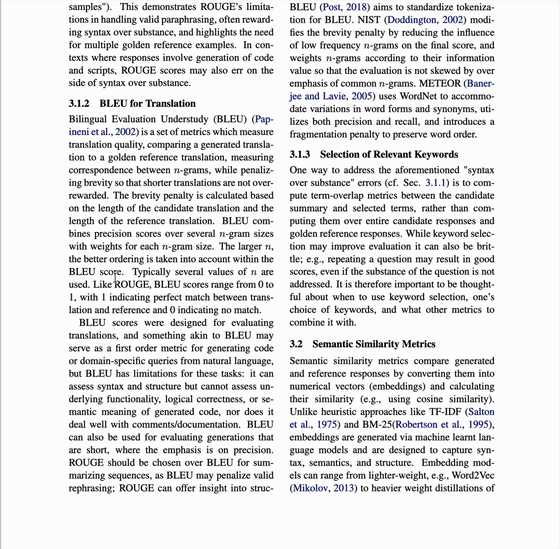
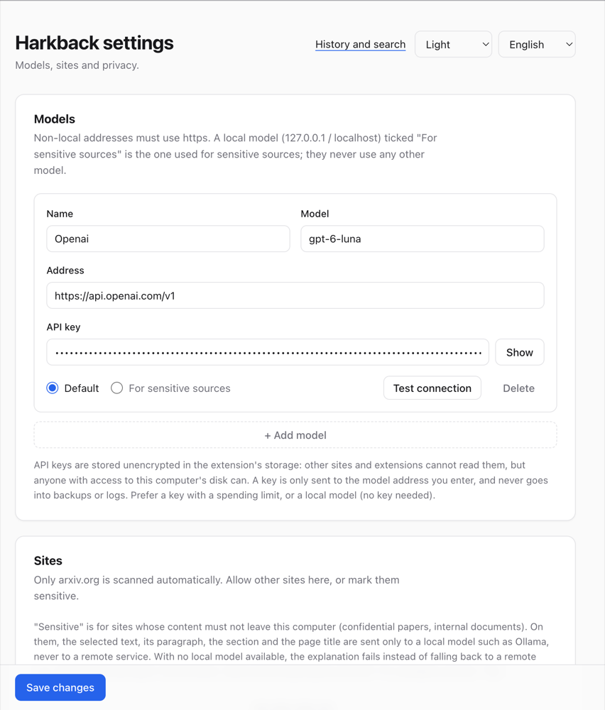

<p align="center">
  
</p>

<h1 align="center">Harkback</h1>

<h3 align="center">
Begriffe beim Lesen erklären lassen. Behalten, was Sie verstanden haben.<br>Es wiederfinden, wenn der Begriff wieder auftaucht.
</h3>

<p align="center">
  <a href="LICENSE"></a>
  <a href="CHANGELOG.md"></a>
  
  
  
  
  <a href="https://github.com/zestworks-io/harkback/stargazers"></a>
  <a href="https://github.com/zestworks-io/harkback/commits/main"></a>
  <a href="CONTRIBUTING.md"></a>
</p>

<p align="center">
| <a href="#schnellstart"><b>Schnellstart</b></a> | <a href="#funktionen"><b>Funktionen</b></a> | <a href="guide/README.md"><b>Dokumentation</b></a> | <a href="#datenschutz"><b>Datenschutz</b></a> | <a href="CHANGELOG.md"><b>Änderungsprotokoll</b></a> | <a href="CONTRIBUTING.md"><b>Mitmachen</b></a> |
</p>

<p align="center"><a href="README.md">English</a> · <a href="README.zh-CN.md">简体中文</a> · <a href="README.zh-TW.md">繁體中文</a> · <a href="README.ja.md">日本語</a> · <a href="README.ko.md">한국어</a> · <a href="README.es.md">Español</a> · <a href="README.fr.md">Français</a> · <b>Deutsch</b> · <a href="README.pt-BR.md">Português (Brasil)</a> · <a href="README.ar.md">العربية</a></p>

Harkback ist eine Chrome-Erweiterung für Menschen, die wissenschaftliche Artikel und technische Dokumente lesen. Markieren Sie einen Begriff, und er wird im Kontext erklärt. Jede Erklärung wird in einem lokalen, nur anfügbaren Protokoll gespeichert. Taucht derselbe Begriff auf einer späteren Seite auf, auch in anderer Schreibweise, unterstreicht Harkback ihn und zeigt, was Sie beim letzten Mal verstanden haben.

> „harken back“: auf einen früheren Punkt zurückkommen.

<p align="center">
  <a href="assets/demo.mp4"></a>
  <br><sub>Markieren Sie einen Begriff in einem PDF, stellen Sie eine Nachfrage, und das ganze Gespräch bleibt erhalten. Klicken Sie auf die Animation für das Video in voller Qualität.</sub>
</p>

## Schnellstart

```sh
git clone https://github.com/zestworks-io/harkback.git && cd harkback
pnpm install && pnpm --filter @harkback/extension build
```

Öffnen Sie `chrome://extensions`, aktivieren Sie den **Entwicklermodus**, wählen Sie **Entpackte Erweiterung laden** und dann `apps/extension/.output/chrome-mv3`. Wählen Sie anschließend ein Modell:

<details open>
<summary><b>Lokales Modell (kostenlos)</b></summary>

Installieren Sie [Ollama](https://ollama.com), laden Sie ein Modell herunter und wählen Sie auf der Einrichtungsseite **Ollama**. Mit _Verbindung testen_ erhalten Sie den einen Befehl, der die Erweiterung zulässt. Nichts verlässt Ihren Computer.

</details>

<details>
<summary><b>Gehostetes Modell (mit eigenem API-Schlüssel)</b></summary>

Wählen Sie OpenAI, Anthropic, Google Gemini, xAI Grok, DeepSeek, Qwen, Moonshot (Kimi), Zhipu GLM, Mistral, OpenRouter oder eine eigene OpenAI-kompatible Adresse und fügen Sie Ihren Schlüssel ein. Der Anbieter rechnet direkt mit Ihnen ab; Harkback hat keinen Server dazwischen.

</details>

Markieren Sie dann auf einer beliebigen Seite einen Begriff und drücken Sie `Alt+Shift+E`. Details finden Sie unter [Installation](#installation) und [Ein Modell verbinden](#ein-modell-verbinden), eine Schritt-für-Schritt-Anleitung unter [Erste Schritte](guide/de/getting-started.md).

<details>
<summary><b>Inhalt</b></summary>

- [Warum nicht einfach ChatGPT fragen?](#warum-nicht-einfach-chatgpt-fragen)
- [Funktionen](#funktionen)
- [Ihr Wissensgraph](#ihr-wissensgraph)
- [So funktioniert es](#so-funktioniert-es)
- [Installation](#installation)
- [Ein Modell verbinden](#ein-modell-verbinden)
- [Harkback benutzen](#harkback-benutzen)
- [Dokumentation](#dokumentation)
- [Datenschutz](#datenschutz)
- [Ihre Daten](#ihre-daten)
- [Einschränkungen](#einschränkungen)
- [Aufbau des Repositorys](#aufbau-des-repositorys)
- [Entwicklung](#entwicklung)
- [Mitmachen](#mitmachen)
- [Lizenz](#lizenz)

</details>

## Warum nicht einfach ChatGPT fragen?

Sie können einen Begriff in einen Chatbot einfügen und bekommen eine gute Antwort. Harkback versucht nicht, eine bessere Antwort zu geben. Es ergänzt, was einem Chatfenster fehlt: **Gedächtnis**. Jeder nachgeschlagene Begriff wird zu einem Eintrag mit Seite, Zitat und Datum, und die Einträge werden zu einem Wissensgraphen verknüpft, der Ihnen gehört.

|                       | Einen Chatbot fragen                                                    | Harkback                                                                                                       |
| --------------------- | ----------------------------------------------------------------------- | -------------------------------------------------------------------------------------------------------------- |
| **Kontext**           | Begriff und etwas Text kopieren, den Tab wechseln                       | Den Begriff auf der Seite markieren; Absatz und Abschnitt gehen mit, und das Zitat wird geprüft                |
| **Beim nächsten Mal** | Ein neuer Chat beginnt leer, oder Sie vergessen, dass Sie gefragt haben | Der Begriff wird auf späteren Seiten unterstrichen, mit dem, was Sie beim letzten Mal verstanden haben         |
| **Struktur**          | Ein Haufen Transkripte                                                  | Konzepte mit Aliasen, Voraussetzungen, Varianten und verwandten Begriffen                                      |
| **Behalten**          | Nichts                                                                  | Eine Wiederholungsliste, geplant von einem Gedächtnismodell: Jeder Begriff kommt kurz vor dem Vergessen zurück |
| **Ihre Einträge**     | Liegen im Konto des Anbieters                                           | Bleiben in Ihrem Browser; Export als Markdown, Obsidian-Notizen oder JSONL                                     |
| **Modell und Kosten** | Ein Dienst, ein Tarif                                                   | Jedes unterstützte Modell: Lokales Ollama kostet nichts, oder Sie nutzen Ihren eigenen API-Schlüssel           |

Harkback ist kostenlos und Open Source (Apache-2.0), hat keinen Server und kein Abo. Es braucht allerdings ein Modell, das die Erklärungen schreibt: Ein lokales Modell ist kostenlos, ein gehostetes rechnet der Anbieter über Ihren eigenen Schlüssel ab.

## Funktionen

- **Im Kontext erklären.** Markieren Sie einen Begriff, klicken Sie auf _Erklären_ oder drücken Sie `Alt+Shift+E`. Die Antwort wird vom eingerichteten Modell gestreamt und als _in der Quelle definiert_ (die Seite definiert den Begriff, und das Zitat wird mit dem Seitentext abgeglichen) oder als _externes Wissen_ gekennzeichnet.
- **Die zitierte Stelle sehen.** Ist eine Erklärung als _In der Quelle definiert_ gekennzeichnet, scrollt _Auf der Seite zeigen_ zu der Stelle, die das Modell zitiert hat, und hebt sie hervor; im Verlauf öffnet die Kennzeichnung die Seite an dieser Stelle.
- **Merken.** Jede Erklärung, Nachfrage und Markierung „Verstanden / Noch unklar“ wird als Ereignis in IndexedDB gespeichert. Nichts verlässt Ihren Browser außer der Modellanfrage, die Sie auslösen.
- **Nachfragen.** Fragen Sie auf der Karte nach; jede Frage bleibt über ihrer Antwort, und das Gespräch wird mit der Erklärung gespeichert. Der Verlauf zeigt es vollständig, die Suche findet es. Formeln werden gesetzt.
- **Wiedersehen.** Auf späteren Seiten werden nachgeschlagene Begriffe unterstrichen. Beim Darüberfahren sehen Sie, wann und wo Sie dem Begriff begegnet sind und was Sie verstanden haben, dazu eine Zeile, welcher Text auf der Seite übereinstimmte. Dann können Sie ihn als gemerkt markieren, noch einmal erklären lassen, die beiden Verwendungen vergleichen oder ihn stummschalten.
- **Ein Konzept, viele Schreibweisen.** `LLM`, `LLMs`, `the LLM`, `large language model` und `Large-Language Models` sind dasselbe Konzept. Ebenso `β-VAE` und `beta-VAE` sowie `fine-tuning` und `fine-tuning` mit Ligatur. Ähnliche Treffer werden Ihnen als „Ist das der Begriff, den Sie vor 3 Tagen nachgeschlagen haben?“ vorgelegt.
- **Verwandte Begriffe.** Sagt ein Modell, dass `QLoRA` eine Variante von `LoRA` ist, erinnert Sie eine Seite, die nur `QLoRA` erwähnt, an das, was Sie über `LoRA` verstanden haben.
- **Konzeptseiten.** Öffnen Sie im Verlauf einen beliebigen Begriff, um zu sehen, wie gut Sie ihn verstanden haben, welche Namen das Modell in Ihrer Sprache vorschlägt (die Sie übernehmen oder ablehnen), worauf er aufbaut (Voraussetzungen), seine Varianten und verwandten Begriffe und jede Begegnung. Beziehungen, bei denen sich das Modell unsicher war, warten unter _Mögliche Beziehungen_, bis Sie sie bestätigen oder entfernen. Sie können einen Alias hinzufügen, zwei gleiche Konzepte zusammenführen, ein Konzept aufteilen, das zwei verschiedene Begriffe vereint hat (das macht auch ein Zusammenführen rückgängig), eine falsche Beziehung entfernen oder einen Begriff stummschalten.
- **Wiederholung.** Der Verlauf zeigt eine Schaltfläche _Wiederholen_ mit der Zahl der fälligen Begriffe. Jeder Begriff wird mit [FSRS-7](https://github.com/open-spaced-repetition/fsrs4anki) geplant, einem Gedächtnismodell: Bewerten Sie eine Antwort mit _Nochmal_, _Schwer_, _Gut_ oder _Leicht_, und der Begriff kommt kurz vor dem Vergessen zurück; die Abstände leichter Begriffe wachsen schnell, schwere kehren bald wieder. Jede Schaltfläche zeigt, wann der Begriff zurückkommt. Sie können eintippen, woran Sie sich erinnern, bevor Sie die Erklärung aufdecken, und die optionale Schaltfläche **Meine Antwort prüfen** fragt Ihr Modell, wie nah Sie dran waren (sie schlägt nur eine Bewertung vor; Sie entscheiden und können sie in den Einstellungen deaktivieren). Die ganze Wiederholung geht per Tastatur: `Leertaste` zeigt die Erklärung, `1`–`4` bewerten, `S` überspringt. Begriffe, die auf anderen aufbauen, kommen nach ihren Voraussetzungen, wenn beide fällig sind, und ein Begriff, mit dem Sie sich schwertun, verweist auf Voraussetzungen, die vielleicht fehlen. Einen Begriff bei einem Wiedersehens-Hinweis als gemerkt zu markieren zählt als leichte Wiederholung. Eine Einstellung legt fest, wie wahrscheinlich Sie sich an einen fälligen Begriff erinnern möchten (standardmäßig 90 %). Das Symbol in der Symbolleiste zeigt die Zahl der fälligen Begriffe; ein Rechtsklick darauf öffnet _Wiederholung_ oder _Verlauf_.
- **Wochenrückblick.** Verlauf → _Wochenrückblick_ zeigt, was Ihnen in einer Woche begegnet ist: neue und wieder begegnete Begriffe, Antworten, Begriffe, die Ihnen noch unklar sind, wo Sie gelesen haben, und neue Verbindungen zwischen Konzepten. Er wird auf Ihrem Computer aus Ihren Einträgen erstellt und ruft kein Modell auf.
- **Baut auf dem auf, was Sie wissen.** Liegt ein nachgeschlagener Begriff nahe an einem, den Sie schon verstehen, wird das dem Modell mitgeteilt, und es kann den Unterschied erklären, statt bei null anzufangen.
- **Privat von Grund auf.** Das automatische Scannen ist auf arxiv.org beschränkt, bis Sie Websites hinzufügen; eine Schaltfläche in den Einstellungen fügt die gängigen Forschungs-Websites hinzu. Sensible Websites können auf ein lokales Modell festgelegt werden, und private Fenster zeichnen nie auf und scannen nie.
- **Portable Einträge.** Exportieren Sie alles als Markdown, als Anki-Karten, als Ordner verknüpfter Notizen (eine Datei pro Konzept mit `[[Links]]`, bereit für Obsidian; was Sie unter der Markierungszeile schreiben, bleibt beim nächsten Export erhalten) oder als versioniertes JSONL-Ereignisprotokoll mit veröffentlichtem JSON-Schema. Eine wöchentliche JSONL-Sicherung wird nach `Downloads/harkback` geschrieben, und **JSONL importieren** im Verlauf stellt sie wieder her (bereits vorhandene Einträge werden übersprungen). Eine Einstellung kann sensible Quellen aus Sicherungen und Exporten auslassen.
- **Import aus Zotero.** Einstellungen → Daten und Datenschutz → _Zotero_ liest die Begriffe, die Sie in Zotero markiert haben (mit einem API-Schlüssel, der Ihre Bibliothek lesen kann, samt den Gruppenbibliotheken, die er lesen darf), und speichert jeden als Nachschlagevorgang in seinem Artikel, sodass er unterstrichen wird, wenn Sie ihm wieder begegnen. Der Kommentar zu einer Markierung wird als Ihre Notiz übernommen. Lange Passagen werden ausgelassen, und in Zotero wird nichts geschrieben. Der Verlauf bietet danach _Mit meinem Modell erklären_ für die importierten Begriffe an.
- **Zur Datenallmende beitragen.** Verlauf → _Beitragen_ erstellt aus Ihren Nachschlagevorgängen in offen lizenzierten arXiv- und DOI-Artikeln eine anonyme Datei: Kennung des Artikels, Lizenz, Begriff, Fachgebiet, Abschnitt, wie gut Sie ihn verstanden haben, und den Monat, dazu die von Ihnen bestätigten Beziehungen. Keine Zitate, Erklärungen, Adressen oder genauen Zeiten und nie eine sensible Quelle. Sie sehen die ganze Datei, bevor Sie sie speichern, und es wird nichts hochgeladen.
- **Stoppen, erneut versuchen, Modell wechseln.** Die Schaltfläche _Stoppen_ beendet eine Antwort, während sie geschrieben wird. Nach einem Fehler bietet die Karte _Erneut versuchen_ und, wenn mehrere Modelle eingerichtet sind, _Mit … versuchen_ für jedes der anderen.
- **Vorschau einer Seite vor dem Lesen.** Klicken Sie auf die Schaltfläche in der Symbolleiste, drücken Sie `Alt+Shift+P` oder nutzen Sie das Kontextmenü, und Harkback bietet an, die Seite zu scannen, und nennt das Modell und ob es ein Remote-Modell ist; ohne Ihre Zustimmung wird nichts gesendet. Ein Modellaufruf wählt die Schlüsselbegriffe der Seite aus, und Ihre eigenen Einträge sortieren sie in _noch unklar_, _etwas verblasst_, _neu für Sie_ und _bekannt_. Die _Vorschau_ zeigt für einen bekannten Begriff Ihre frühere Erklärung, für einen neuen eine kurze, vom Modell geschriebene, und zeichnet nichts auf. Das Modell sieht nur den Seitentext, nie Ihre Konzeptliste, und eine sensible Seite nutzt nur ein lokales Modell. Ein Scan liest die ersten 16.000 Zeichen einer Seite und sagt Ihnen, wenn eine längere Seite abgeschnitten wurde.
- **YouTube-Untertitel.** Fügen Sie YouTube in den Einstellungen hinzu, und bei eingeschalteten Untertiteln werden bereits nachgeschlagene Begriffe in der Untertitelzeile unterstrichen. Halten Sie an und markieren Sie einen Begriff, um ihn anhand der bisher gesehenen Untertitel erklären zu lassen. Automatische Untertitel aus der Spracherkennung werden großzügiger abgeglichen: `lora` für LoRA, `r l h f` für RLHF, ein Name, bei dem ein oder zwei Buchstaben abweichen, oder einer, der als gleich klingendes Wort verstanden wurde. Das Nachschlagen wird mit der Wiedergabeposition (`12:34`) aufgezeichnet, und Verlauf, Wiederholung und Exporte verlinken auf diesen Moment. Aus, bis Sie die Website hinzufügen; es wird nichts heruntergeladen, nur die auf dem Bildschirm sichtbare Untertitelzeile wird gelesen.
- **GitHub, Notion und Google Docs.** Fügen Sie die Website in den Einstellungen hinzu, und ihre Seiten werden nach ihrem eigenen Layout gelesen: die README eines Repositorys, die Unterhaltung in einem Issue oder Pull Request, eine Notion-Seite, die veröffentlichte oder mobile Ansicht eines Google-Dokuments. Ein Dokument ist eine Quelle, egal wie Sie dorthin gelangt sind, und es wird nur sein eigener Text gelesen, nicht die Menüs drumherum.
- **Fragt vor dem Senden einer privaten Seite.** Eine Seite, die privat wirkt, etwa ein privates GitHub-Repository oder eine nicht veröffentlichte Notion- oder Google-Docs-Seite, wird an kein Modell gesendet, bis Sie _Nur lokal_ oder _Trotzdem senden_ wählen. Ein Schloss in der Ecke der Seite zeigt den Zustand an und ändert ihn; Ihre Wahl wird aufgezeichnet und kann für die Website gemerkt werden.
- **Mehrere Wege zum Start.** Markieren Sie Text und klicken Sie auf _Erklären_ (Auswahl per Maus, Tastatur oder Touch), drücken Sie `Alt+Shift+E` oder nutzen Sie _Erklären_ im Kontextmenü. Seiten, die mehr Text nachladen oder ohne Neuladen zu einer anderen Seite wechseln, werden erneut gescannt.
- **Ihr Modell, Ihre Wahl.** Das in Chrome eingebaute Gemini Nano (auf Ihrem Computer, nichts einzurichten), Ollama, OpenAI, Anthropic, Google Gemini, xAI Grok, DeepSeek, Qwen, Moonshot (Kimi), Zhipu GLM, Mistral, OpenRouter oder jeder OpenAI-kompatible Server. Anthropic und Gemini nutzen ihre nativen APIs.

## Ihr Wissensgraph

Jedes Nachschlagen erweitert einen Graphen dessen, was Sie gelesen haben, aufgebaut aus Ihrer eigenen Lektüre und nicht aus dem Gedächtnis eines Allzweckmodells.

- **Konzepte sind die Knoten.** `LoRA` ist ein Knoten, egal welche Schreibweise eine Seite verwendet (`LoRA`, `low-rank adaptation`) und in welcher Sprache Sie ihm begegnet sind. Er behält seine Aliase, sein Fachgebiet und wie gut Sie ihn verstanden haben.
- **Beziehungen sind die Kanten.** Ein Modell schlägt beim Nachschlagen eines Begriffs `variant_of`-, `prerequisite`- und `related`-Verknüpfungen vor, zum Beispiel ist `QLoRA` eine Variante von `LoRA`. Eine Verknüpfung, bei der sich das Modell unsicher war, steht unter _Mögliche Beziehungen_ und wird erst verwendet, wenn Sie sie bestätigen. Sie können eine falsche entfernen, zwei gleiche Konzepte zusammenführen, ein Konzept aufteilen, das zwei verschiedene Begriffe vereint hat, oder einen Alias hinzufügen.
- **Alles verweist auf Belege.** Ein Konzept listet jede Begegnung: die Seite, das Zitat, das Datum, Ihre Erklärung und die Nachfragen.
- **Der Graph arbeitet mit.** Eine Seite, die nur `QLoRA` erwähnt, erinnert Sie an `LoRA`, dem Modell wird gesagt, was Sie schon wissen, damit es den Unterschied erklären kann, und die Wiederholung wird pro Konzept geplant.
- **Er gehört Ihnen.** Exportieren Sie einen Ordner verknüpfter Notizen (`[[Links]]`, eine Datei pro Konzept) und öffnen Sie ihn in Obsidian, um dort den Graphen zu sehen, oder exportieren Sie das vollständige Ereignisprotokoll als JSONL.

Öffnen Sie **Graph** im Verlauf, um ihn als Karte zu sehen: Konzepte werden danach eingefärbt, wie gut Sie sie verstanden haben (verstanden, unsicher, unklar oder neu), mit Pfeilen für Voraussetzungen und Varianten. Filtern Sie nach Fachgebiet, Verständnis oder dem Zeitpunkt, zu dem Sie einen Begriff zuletzt nachgeschlagen haben. Ziehen verschiebt, Scrollen zoomt, ein Klick auf ein Konzept öffnet es. Sie können ihn auch über Konzeptseiten durchstöbern und, nach dem Export, über Obsidian.

## So funktioniert es

```
 lesen               erklären                merken                   wiederfinden
 ─────               ────────                ──────                   ────────────
 content script  →   background worker   →   nur anfügbares       →   der Matcher durchsucht die
 liest den Seiten-   wählt je nach           Ereignisprotokoll        nächste Seite nach bekannten
 text aus und        Sensibilität der Seite  (IndexedDB), wird zu     Namen, wählt die zeigens-
 verfolgt Ihre       ein Modell, streamt     Konzepten, Aliasen und   werten Konzepte aus und
 Auswahl             die Antwort, löst das   Begegnungen abgespielt   zeichnet Unterstreichung
                     Konzept auf                                      + Karte
```

1. **Lesen.** Ein Content-Script extrahiert den lesbaren Text der Seite (LaTeXML-Struktur auf arXiv, sonst Readability) und führt eine Zuordnung von Textpositionen zu DOM-Knoten.
2. **Erklären.** Der Background-Worker prüft die Website-Regeln, wählt ein Modell, wendet eine lokale Ratenbegrenzung an und sendet den Begriff mit seinem Absatz. Der Prompt listet bekannte Konzepte als Kandidaten auf, damit das Modell sagen kann: „Das ist dasselbe Konzept wie c1.“ Die Antwort wird fehlertolerant ausgewertet: Abgeschnittene Karten, nachgestellte Kommas und verzierte Bezeichnungen werden toleriert.
3. **Merken.** Das Ergebnis wird zu Ereignissen (`concept.created`, `encounter.created`, `edge.proposed`, ...). Konzepte, Aliase und Zusammenführungen werden durch Abspielen des Protokolls abgeleitet und nie gespeichert, sodass eine bessere Abgleichsregel auch alte Einträge verbessert.
4. **Wiederfinden.** Auf jeder Seite durchsucht ein Aho-Corasick-Matcher den Text nach allen bekannten Namen und Abkürzungen. Die Auswahl der Wiedersehens-Hinweise wendet dann die Regeln an, die sie nützlich halten: nicht auf der Seite, auf der Sie den Begriff nachgeschlagen haben, nicht innerhalb eines Mindestabstands, stummgeschaltete Konzepte bleiben stumm, und eine mehrdeutige Abkürzung braucht einen zweiten Begriff desselben Fachgebiets auf der Seite.

## Installation

Installieren Sie Harkback aus dem [Chrome Web Store](https://chromewebstore.google.com/detail/joancadfahbgmadnjldekohffbffmodo). Die Einrichtungsseite öffnet sich bei der Installation.

Um die Erweiterung stattdessen aus dem Quellcode zu laden, brauchen Sie Node 22 oder neuer und [pnpm](https://pnpm.io):

```sh
# im Wurzelverzeichnis des Repositorys
pnpm install
pnpm --filter @harkback/extension build
```

Öffnen Sie `chrome://extensions`, aktivieren Sie den **Entwicklermodus**, wählen Sie **Entpackte Erweiterung laden** und dann `apps/extension/.output/chrome-mv3`. Die Einrichtungsseite öffnet sich bei der Installation.

**Microsoft Edge.** Führen Sie `pnpm build -b edge` in `apps/extension` aus (oder `pnpm zip:edge`), öffnen Sie `edge://extensions`, aktivieren Sie den **Entwicklermodus**, wählen Sie **Entpackte Erweiterung laden** und dann `apps/extension/.output/edge-mv3`. Edge bietet das in Chrome eingebaute Modell möglicherweise nicht an; wählen Sie bei der Einrichtung ein anderes Modell.

## Ein Modell verbinden

Die Einrichtung hat drei Schritte: **Willkommen** (ein Beispiel für einen Wiedersehens-Hinweis und eine eingebaute Beispielerklärung, die Sie ohne Modellaufruf ausprobieren können), **Datenschutz** (wohin Ihr Text geht; Sie müssen das Zustimmungsfeld ankreuzen, damit _Weiter_ aktiv wird) und **Modell** (einen Anbieter wählen, dann _Einrichtung abschließen_). Wenn Sie die Einrichtung erneut durchlaufen, wird das vorhandene Modell aktualisiert, statt eine Kopie anzulegen. Brechen Sie die Einrichtung vor dem Ende ab, weist die Einstellungsseite darauf hin und führt Sie dorthin zurück. Weitere Modelle hinzufügen und Optionen ändern können Sie später auf der Einstellungsseite; dort legen Sie auch Ratenlimits und Wiedersehens-Hinweise fest und wie lange ein Modell schweigen darf, bevor eine Anfrage aufgegeben wird.



| Anbieter                       | Base URL                                            | Hinweise                                                                                                                                                                                                 |
| ------------------------------ | --------------------------------------------------- | -------------------------------------------------------------------------------------------------------------------------------------------------------------------------------------------------------- |
| Ollama                         | `http://127.0.0.1:11434/v1`                         | Lokal, kein Schlüssel. Siehe unten.                                                                                                                                                                      |
| Chrome eingebaut (Gemini Nano) | keine                                               | Auf diesem Computer, kein Schlüssel. Bei der Einrichtung oder in den Einstellungen herunterladen. Ein kleines Modell: langsamer als ein Cloud-Modell und am besten auf Englisch, Spanisch und Japanisch. |
| OpenAI                         | `https://api.openai.com/v1`                         | Braucht einen API-Schlüssel.                                                                                                                                                                             |
| Anthropic                      | `https://api.anthropic.com/v1`                      | Braucht einen API-Schlüssel.                                                                                                                                                                             |
| Google Gemini                  | `https://generativelanguage.googleapis.com/v1beta`  | Braucht einen API-Schlüssel.                                                                                                                                                                             |
| xAI Grok                       | `https://api.x.ai/v1`                               | Braucht einen API-Schlüssel.                                                                                                                                                                             |
| DeepSeek                       | `https://api.deepseek.com`                          | Braucht einen API-Schlüssel.                                                                                                                                                                             |
| Qwen (Alibaba Cloud)           | `https://dashscope.aliyuncs.com/compatible-mode/v1` | Braucht einen API-Schlüssel. Ein Schlüssel funktioniert nur in der Region, in der er erstellt wurde; für die andere Region die Adresse anpassen.                                                         |
| Moonshot (Kimi)                | `https://api.moonshot.ai/v1`                        | Braucht einen API-Schlüssel. Ein Schlüssel funktioniert nur in der Region, in der er erstellt wurde; für die andere Region die Adresse anpassen.                                                         |
| Zhipu GLM                      | `https://open.bigmodel.cn/api/paas/v4`              | Braucht einen API-Schlüssel.                                                                                                                                                                             |
| Mistral                        | `https://api.mistral.ai/v1`                         | Braucht einen API-Schlüssel.                                                                                                                                                                             |
| OpenRouter                     | `https://openrouter.ai/api/v1`                      | Braucht einen API-Schlüssel.                                                                                                                                                                             |
| Benutzerdefiniert              | jede Adresse                                        | `https`, außer für diesen Computer und Ihr eigenes Netzwerk (`192.168.x.x`, `10.x.x.x`, `name.local`, Tailscale).                                                                                        |

Jeder Anbieter spricht sein eigenes Format: Anthropic und Google Gemini nutzen ihre nativen APIs, alles andere, einschließlich Ollama, Grok, DeepSeek, Qwen, Moonshot, Zhipu, Mistral, OpenRouter und jeder benutzerdefinierten Adresse wie einem Firmen-Proxy, nutzt das OpenAI-kompatible Format. Die Wahl eines Anbieters trägt seine Adresse ein, die Sie weiterhin bearbeiten können. Wählen Sie **Benutzerdefiniert** für jeden anderen OpenAI-kompatiblen Dienst.

Chrome bittet Sie, den Zugriff auf die Adresse des Modells zu erlauben, wenn Sie sie zum ersten Mal testen oder speichern. Lehnen Sie ab, weist die Erklärkarte darauf hin, statt mit einem Netzwerkfehler zu scheitern.

**Ollama** lehnt Anfragen von Browser-Erweiterungen ab, solange der Ursprung der Erweiterung nicht erlaubt ist. Die Schaltfläche _Verbindung testen_ zeigt den genauen Befehl für Ihr System, zum Beispiel unter macOS:

```sh
launchctl setenv OLLAMA_ORIGINS "chrome-extension://<your-extension-id>"
```

Starten Sie danach Ollama neu.

## Harkback benutzen

| Sie möchten                                                        | So geht's                                                                                                                                                                                                                                                       |
| ------------------------------------------------------------------ | --------------------------------------------------------------------------------------------------------------------------------------------------------------------------------------------------------------------------------------------------------------- |
| Einen Begriff erklären lassen                                      | Markieren Sie ihn und klicken Sie auf **Erklären** oder drücken Sie `Alt+Shift+E`.                                                                                                                                                                              |
| Nachfragen                                                         | Nutzen Sie **Nachfragen** auf der Karte. Frage und Antwort werden mit der Erklärung gespeichert.                                                                                                                                                                |
| Eine Seite scannen, die nicht auf arXiv ist                        | Klicken Sie auf die Schaltfläche in der Symbolleiste oder erlauben Sie die Website in den Einstellungen unter _Websites_ für automatische Scans.                                                                                                                |
| Ein PDF lesen                                                      | Klicken Sie auf dem PDF auf die Schaltfläche in der Symbolleiste: arXiv-Artikel öffnen sich als HTML, andere PDFs im Reader.                                                                                                                                    |
| Sehen, was Sie nachgeschlagen haben                                | Öffnen Sie die Verlaufsseite von der Einstellungs- oder Einrichtungsseite aus oder per Rechtsklick auf das Symbol in der Symbolleiste → **Verlauf**. Sie aktualisiert sich live, und der Quellentitel jedes Eintrags verlinkt auf die Seite, von der er stammt. |
| Fällige Begriffe wiederholen                                       | Verlaufsseite → **Wiederholen** oder Rechtsklick auf das Symbol in der Symbolleiste → **Wiederholung**.                                                                                                                                                         |
| Einen Begriff korrigieren, der dem falschen Konzept zugeordnet ist | Konzeptseite → **Aufteilen…**: Haken Sie die Nachschlagevorgänge und Namen an, die woanders hingehören, und benennen Sie das neue Konzept.                                                                                                                      |
| Zur Datenallmende beitragen                                        | Verlaufsseite → **Beitragen**: Prüfen Sie die Datei, dann **Beitragsdatei speichern**. Es wird nichts hochgeladen.                                                                                                                                              |
| Übernehmen, was Sie in Zotero markiert haben                       | Einstellungen → **Daten und Datenschutz** → **Zotero**: API-Schlüssel einfügen, **Markierungen suchen**, dann **Angehakte Begriffe importieren**.                                                                                                               |
| Ihre Einträge aufbewahren                                          | Verlaufsseite → **Markdown exportieren**, **Anki-Karten exportieren** oder **JSONL jetzt sichern**.                                                                                                                                                             |
| Aus einer Sicherung wiederherstellen                               | Verlaufsseite → **JSONL importieren**.                                                                                                                                                                                                                          |
| Sehen, wie Konzepte zusammenhängen                                 | Verlaufsseite → **Graph**.                                                                                                                                                                                                                                      |
| Verhindern, dass ein Begriff unterstrichen wird                    | Über die Unterstreichung fahren → **Nicht mehr anzeigen**.                                                                                                                                                                                                      |
| Eine Quelle von Remote-Modellen fernhalten                         | Karte → **Quelle als sensibel markieren** oder in den Einstellungen eine Website-Regel mit „Sensibel“ hinzufügen.                                                                                                                                               |
| Eine Seite klären, die privat wirkt                                | Das Schloss in der Ecke der Seite oder die Frage bei Ihrer ersten Erklärung: **Nur lokal** oder **Trotzdem senden**.                                                                                                                                            |

## Dokumentation

Der Ordner [`guide/`](guide/README.md) enthält die Details (auf Englisch, außer [Erste Schritte](guide/de/getting-started.md)):

- [Erste Schritte](guide/de/getting-started.md), das [Benutzerhandbuch](guide/user-guide.md), [Modelle und Anbieter](guide/models.md) und [Fehlerbehebung](guide/troubleshooting.md).
- [Datenschutz und sensible Quellen](guide/privacy.md): was gesendet wird, was nie, und wie das durchgesetzt wird.
- [Architektur](guide/architecture.md) und das [Datenformat](guide/data-format.md), für Mitwirkende und für alle, die auf ihren Einträgen aufbauen wollen.
- Das [Änderungsprotokoll](CHANGELOG.md).

## Datenschutz

- Wenn Sie eine Erklärung anfordern, gehen der markierte Text, sein Absatz, der Abschnitt und der Seitentitel an den von Ihnen eingerichteten Modelldienst, zu den Bedingungen dieses Anbieters.
- In der Wiederholung sendet die optionale Schaltfläche **Meine Antwort prüfen** den Begriff, Ihre eingetippte Antwort und die gespeicherte Erklärung an Ihr Modell, nur wenn Sie darauf klicken. Deaktivieren Sie sie in den Einstellungen, erscheint die Schaltfläche nie. Es gelten dieselben Regeln für Modell und sensible Quellen wie bei einer Erklärung.
- Einträge bleiben in diesem Browser. Sicherungen enthalten nur Einträge, nie Einstellungen oder API-Schlüssel.
- Seiten werden nur auf arxiv.org automatisch gescannt. Überall sonst müssen Sie auf die Schaltfläche klicken, `Alt+Shift+E` drücken oder die Website erlauben.
- Inhalte aus einer sensiblen Quelle werden nie an ein nicht lokales Modell gesendet, auch nicht als Kontext für spätere Vergleiche. Ein Server in Ihrem eigenen Netzwerk gilt als nicht lokal. Eine Quelle bleibt sensibel, bis Sie sie in ihrem Verlaufseintrag wieder als normal markieren.
- Eine Seite, die privat wirkt (ein privates GitHub-Repository; eine nicht veröffentlichte Notion- oder Google-Docs-Seite), wird an kein Modell gesendet, bis Sie entscheiden. Bei Seiten, die die Website weder als privat noch als öffentlich kennzeichnet, wird auf Notion und Google Docs gefragt, auf GitHub nicht. Was eine Seite über sich selbst verrät, ist nur ein Hinweis; markieren Sie eine Website also als sensibel, wenn es darauf ankommt.
- Eine Einstellung lässt sensible Quellen aus Sicherungen und Exporten aus. Eine solche Sicherung merkt sich nicht, welche Quellen sensibel waren, und Website-Regeln sind nie in Sicherungen enthalten.
- **Markierungen suchen** unter Einstellungen → Zotero sendet Ihren Zotero-API-Schlüssel an `api.zotero.org` und liest Ihre Markierungen, nur wenn Sie darauf klicken. In Zotero wird nichts geschrieben; Dateien, die keine veröffentlichten Artikel sind, werden als sensibel gespeichert.
- **Beitragen** im Verlauf speichert eine anonyme Datei auf Ihrem Computer, nur aus offen lizenzierten Artikeln und nie aus einer sensiblen Quelle. Es wird nichts hochgeladen; ob Sie sie irgendwo einreichen, entscheiden Sie.
- Private Fenster erklären, zeichnen aber nie auf, scannen nie und zeigen nie Wiedersehens-Hinweise an.
- Die Unterstreichungen der Wiedersehens-Hinweise sind Teil der Seite, daher können die eigenen Skripte der Seite ableiten, zu welchen Begriffen Sie Einträge haben.
- Das Löschen einer Erklärung entfernt sie in der App und löscht ihren Text aus dem Protokoll; der Name des Begriffs sowie Titel und Adresse der Quelle bleiben erhalten. Auf dem Datenträger können Spuren bleiben, und exportierte Sicherungen lassen sich nicht zurückrufen.
- API-Schlüssel (für Modelle und Zotero) werden **unverschlüsselt** im Speicher der Erweiterung abgelegt.

Maßgeblich sind die in der Erweiterung angezeigten Hinweise: [`apps/extension/src/lib/pages/privacy.ts`](apps/extension/src/lib/pages/privacy.ts).

## Ihre Daten

Alles ist ein Ereignis in einem nur anfügbaren Protokoll. Das Format ist öffentlich:

- Ereignistypen und Nutzdaten: [`packages/spec`](packages/spec), mit dem erzeugten [JSON-Schema](packages/spec/schema/event.schema.json).
- Abspielen, Abgleich und Export: [`packages/core`](packages/core), das keine Browser-Abhängigkeiten hat und eigenständig verwendet werden kann.

Da Konzepte und Aliase aus dem Protokoll abgeleitet werden, ist Ihre JSONL-Sicherung eine vollständige, portable Kopie dessen, was Sie wissen.

## Einschränkungen

- Chrome und Microsoft Edge (Manifest V3). Firefox und Safari werden nicht unterstützt. Das in Chrome eingebaute Modell ist nicht in jedem Browser verfügbar; Edge braucht ein anderes Modell.
- Erklärungen hängen vom gewählten Modell ab; kleine lokale Modelle liefern womöglich schwächere Konzeptkarten, was die Qualität des Wiederfindens senkt, das Aufzeichnen aber nie beeinträchtigt.
- Text im eingebauten PDF-Viewer des Browsers lässt sich nicht lesen, daher öffnet Harkback das PDF auf einer eigenen Reader-Seite (arXiv-Artikel gehen stattdessen zur HTML-Version). Gescannte PDFs werden per OCR auf Ihrem Computer gelesen (Englisch ist eingebaut; weitere Sprachen sind je ein Download von `jsdelivr.net`). Das ist langsamer und ungenauer als echter Text und stellt Handschrift, Formeln und Tabellen nicht wieder her, und die Absatzerkennung bei komplizierten Layouts (Tabellen, Abbildungen mit Text, drei oder mehr Spalten) ist nur ungefähr. Ein PDF auf Ihrem Computer braucht zwei Freigaben: Aktivieren Sie „Zugriff auf Datei-URLs zulassen“ für Harkback in `chrome://extensions` und klicken Sie beim ersten Mal auf der Reader-Seite auf „Lokale Dateien zulassen“.
- Der automatische Abgleich von Abkürzungen braucht mindestens drei Wörter im vollen Namen (`LLM` aus `Large Language Model`). Zwei Abkürzungen, die im selben Fachgebiet für verschiedene volle Namen stehen (zum Beispiel zwei verschiedene „GNN“), bleiben getrennte Konzepte.
- Chinesische Namen und japanische Namen, die nur in Kanji geschrieben sind, werden ab drei Zeichen überall unterstrichen, wo sie vorkommen. Ein Name aus zwei Han-Zeichen wird nur dort unterstrichen, wo das Wörterbuch des Browsers ihn auf der Seite als eigenständiges Wort erkennt, was einen Browser mit `Intl.Segmenter` voraussetzt; ein Name aus einem Zeichen nie. Namen mit Kana oder Hangul brauchen zwei Zeichen. Vereinfachte und traditionelle Schreibweisen der gängigen Fachzeichen gelten als ein Begriff. Halbbreite Katakana mit separatem Stimmhaftigkeitszeichen werden nicht erkannt.
- YouTube: Es werden nur `www.youtube.com/watch`-Seiten mit eingeschalteten Untertiteln (CC) gelesen, und nur die Untertitelzeilen, die der Player seit dem Öffnen der Seite angezeigt hat, stehen als Kontext zur Verfügung. Automatische Untertitel werden großzügiger abgeglichen als Seiten, aber ein Begriff, der als etwas ganz anderes verstanden wurde (`lower` für LoRA), passt nicht zu Ihren Einträgen. Shorts, eingebettete Player auf anderen Websites und der Vollbildmodus (der Player verbirgt die Hinweise von Harkback; nutzen Sie den Kinomodus) werden nicht unterstützt, und eine Änderung der YouTube-Seite kann das Lesen der Untertitel verhindern, bis Harkback aktualisiert wird.
- GitHub, Notion und Google Docs: Es werden nur Repository-Startseiten, Issues und Pull Requests (keine Codedateien), Notion-Seiten und Google-Dokumente in ihrer veröffentlichten oder mobilen Ansicht gelesen. Notion zeigt nur die Blöcke, die es bereits gezeichnet hat, daher wird eine lange Seite möglicherweise nur teilweise gelesen. Der Google-Docs-Editor zeichnet seinen Text selbst und lässt sich nicht lesen, und die Vorschauansicht wurde nicht geprüft. Diese Websites ändern ihr Layout ohne Vorankündigung; erkennt Harkback eine nicht mehr, liest es die Seite wie jede andere, bis es aktualisiert wird.
- Akzente werden beim Abgleich ignoriert („résumé“ und „resume“ sind ein Begriff), aber es gibt keine Stammformreduktion für andere Sprachen als Englisch, daher sind gebeugte Formen wie deutsche Plurale eigene Begriffe. Im Arabischen werden Vokalzeichen, der Dehnungsstrich und die Schreibvarianten von Alif, Ya und Ta marbuta ignoriert, und ein Name wird auch mit den einbuchstabigen und Artikel-Präfixen (`و`, `ب`, `ل`, `ك`, `ف`, `ال`, `بال`, `وال`) und den gängigen Plural- und Pronomenendungen unterstrichen; andere Flexion wird nicht erkannt.
- Die Oberfläche ist standardmäßig Englisch und auch in vereinfachtem und traditionellem Chinesisch, Japanisch, Koreanisch, Spanisch, Französisch, Deutsch, brasilianischem Portugiesisch und Arabisch verfügbar (von rechts nach links; maschinell übersetzt, noch nicht von Muttersprachlern geprüft). Erklärungen können in 16 Sprachen geschrieben werden, die Sie getrennt in den Einstellungen wählen. Exportierte Notizen und Markdown verwenden nur englische oder chinesische Bezeichnungen.

## Aufbau des Repositorys

| Pfad             | Was es ist                                                                                                                                              |
| ---------------- | ------------------------------------------------------------------------------------------------------------------------------------------------------- |
| `packages/spec`  | Das Ereignisformat: Konstanten, zod-Schemas und das erzeugte JSON-Schema.                                                                               |
| `packages/core`  | Reine Logik: Abspielen, Namensnormalisierung, Konzeptabgleich, Auswahl der Wiedersehens-Hinweise, Prompts, Ausgabe-Parsing, JSONL- und Markdown-Export. |
| `apps/extension` | Die Chrome-Erweiterung, gebaut mit [WXT](https://wxt.dev): Content-Script, Background-Worker, Verlauf, Einstellungen und Einrichtung.                   |
| `tools/lint`     | ESLint-Konfiguration.                                                                                                                                   |
| `tools/eval`     | `pnpm eval`: misst die Qualität der Erklärungen an einem annotierten Satz von Textpassagen, mit einem echten Modell.                                    |
| `guide`          | Die Dokumentation: Benutzerhandbuch, Modelle, Datenschutz, Architektur, Datenformat.                                                                    |

## Entwicklung

```sh
pnpm install
pnpm --filter @harkback/extension dev     # Live-Reload
```

Bevor Sie einen Pull Request öffnen:

```sh
pnpm typecheck     # alle Pakete
pnpm lint          # ESLint
pnpm test          # Unit-Tests
pnpm check:build   # Produktions-Build: Manifest-Berechtigungen und Content-Script-Größe (unter 130 KB)
pnpm e2e           # End-to-End-Tests in Chromium (einmal `pnpm exec playwright install chromium` ausführen)
pnpm format:check  # Formatierung
```

Um ein Release für Microsoft Edge Add-ons zu paketieren, führen Sie `pnpm zip:edge` aus (siehe `store/edge/README.md`). Um ein Release für den Chrome Web Store zu paketieren, erhöhen Sie `version` in `apps/extension/package.json` und führen dann `pnpm release` aus. Das führt die Prüfungen aus, baut die Produktionserweiterung, verifiziert das Paket und schreibt `apps/extension/.output/harkback-<version>-chrome.zip`. Mit `tools/package.sh --skip-checks` wird nur das Zip gebaut.

Die End-to-End-Tests laden die gebaute Erweiterung in Chromium, liefern arXiv-Seiten aus `apps/extension/fixtures` aus und sprechen mit einem lokalen Stub-Modellserver. Sie decken den ganzen Kreislauf ab: einen Artikel lesen, erklären, aufzeichnen, die Verlaufsseite und Wiedersehens-Hinweise in anderen Artikeln. Siehe `apps/extension/e2e`.

Wenn Sie den Prompt, den Antwort-Parser oder den Matcher ändern, misst `pnpm eval` die Qualität der Erklärungen mit einem echten Modell und prüft die Release-Schwellen. Siehe [CONTRIBUTING.md](CONTRIBUTING.md#measuring-explanation-quality).

## Mitmachen

Fehlerberichte und Pull Requests sind willkommen. Lesen Sie zuerst [CONTRIBUTING.md](CONTRIBUTING.md). Wie Sie ein Sicherheitsproblem melden, steht in [SECURITY.md](SECURITY.md).

## Lizenz

[Apache-2.0](LICENSE)
